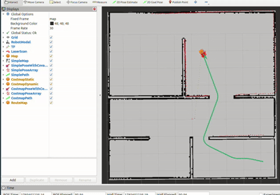
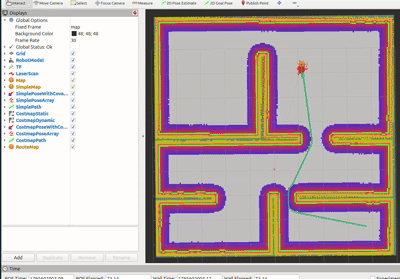

## EasyNav Lazy Theta Planner (ROS2)

*A lightweight Lazy Theta-P planner for ROS 2 [EasyNav](https://github.com/EasyNavigation)*


</br>



**easynav_lazy_theta_planner** is a ROS 2 [EasyNav](https://github.com/EasyNavigation) planner plugin implementing Lazy Theta*, an any-angle pathfinding algorithm for grid-based navigation.</br>
Unlike conventional grid-based planners that produce paths constrained to grid edges, Lazy Theta* can generate paths with fewer directional changes and more direct trajectories.</br>
Seeing there's no any angle planner for [EasyNav](https://github.com/EasyNavigation) (only A* planner is implemented), I develped this as an addon to the list os easynav planners</br>

The planner is experimental and open for anyone to try, test, and contribute to.

---

### Features

- **Any-angle path planning**: Produces paths that are not restricted to grid directions.

- **Straight paths**: Reduces unnecessary turns and grid-aligned movement.

- **Lazy Theta-P**: Uses lazy line-of-sight checking to reduce computational overhead (uses same algorithm as Nav2 Theta Star).

- **Cost-aware planning**: Accounts for costmap traversal costs when evaluating paths.

- **Inflation layer shortcut control**: Allows control over how aggressively the planner shortcuts through inflated regions.

- **Easy tuning**: Exposes a small number of parameters for adjusting path behavior.

- **EasyNav compatible** Implemented as an EazyNav global planner plugin.

---

### Example Usage
```yaml
planner_node:
  ros__parameters:
    use_sim_time: true
    planner_types: [costmap]
    costmap:
      freq: 0.5
      plugin: easynav_lazy_theta_costmap_planner/LazyThetaCostmapPlanner
      los_shortcut_cost_limit_: 5 # Strict limit for line-of-sight shortcuts through the inflation layer (value ranges from 1-100)
      cost_travel_multiplier_: 3.0 # Weight for penalizing traversal through inflation (try values between 1.0 to 3.0)
      continuous_replan_: true    # Wheter replan path at freq time
```

---

### Parameters

| Parameter | Default | Description |
|---|---|---|
| `los_shortcut_cost_limit` | `5` | Controls the allowable cost when performing line-of-sight shortcuts through the inflation layer. Values range from 1 to 100. Lower values provide stricter shortcut conditions. |
| `cost_travel_multiplier` | `3.0` | Weight applied to traversal costs when evaluating paths through inflated regions. Higher values discourage paths closer to obstacles. (try values between 1.0 to 3.0)|

---

### 📚 Reference Resources:

- **Lazy Theta*** - Alex Nash et al.  
  [Lazy Theta*: Any-Angle Path Planning with Lazy Updates](http://idm-lab.org/bib/abstracts/papers/aaai10b.pdf)

- **Self-Driving Planning Course** - Antonio Brandi  
  [Udemy Course](https://www.udemy.com/share/10d4U53@J5jcGUgRzDALXhLAGOMWxU6dAnWoZ-g8zGFl1djv_uJFHfRN5X0qLnnhFUJ_xl7J/)

- **Improved AStar** - Dr. Oluwaseun Martins  
  [Research Paper](https://www.sciencedirect.com/science/article/pii/S2468227621003690)

- **Nav2 ThetaStar Planner** - Nav2 Developers  
  [Source Code](https://github.com/ros-navigation/navigation2/blob/jazzy/nav2_theta_star_planner/src/theta_star.cpp)

- **EasyNav AStar Planner Plugin** - EasyNav Developers  
  [Repository](https://github.com/EasyNavigation/easynav_plugins)

---

## Acknowledgements

This project was inspired by existing work in any-angle path planning, Lazy Theta*, and ROS 2 navigation.

Special thanks to the authors and developers of the referenced algorithms, research, and open-source projects.

---

### MoboBot (Implementation)

[MoboBot](https://github.com/robocre8/mobo_bot) is a robotics project developed by [samuko-things](https://github.com/samuko-things) under [robocre8](https://github.com/robocre8).

---

## Contributing

Contributions, bug reports, suggestions, and testing feedback are welcome.

If you try this planner in your robot or simulation, feel free to share your results and experiences.

---

## License

**MIT**